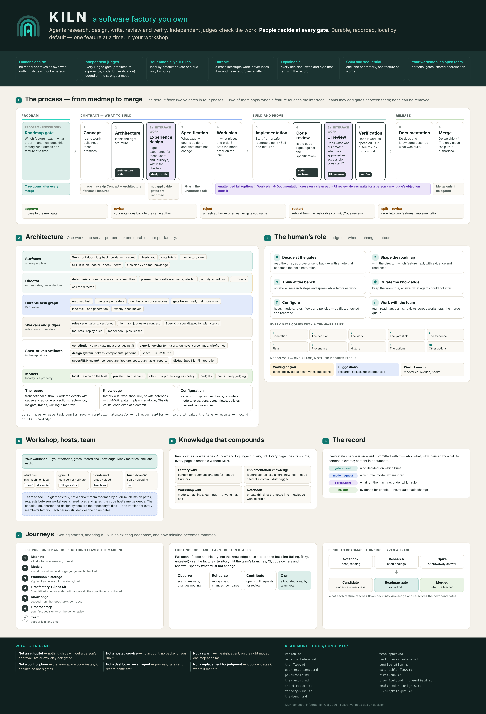
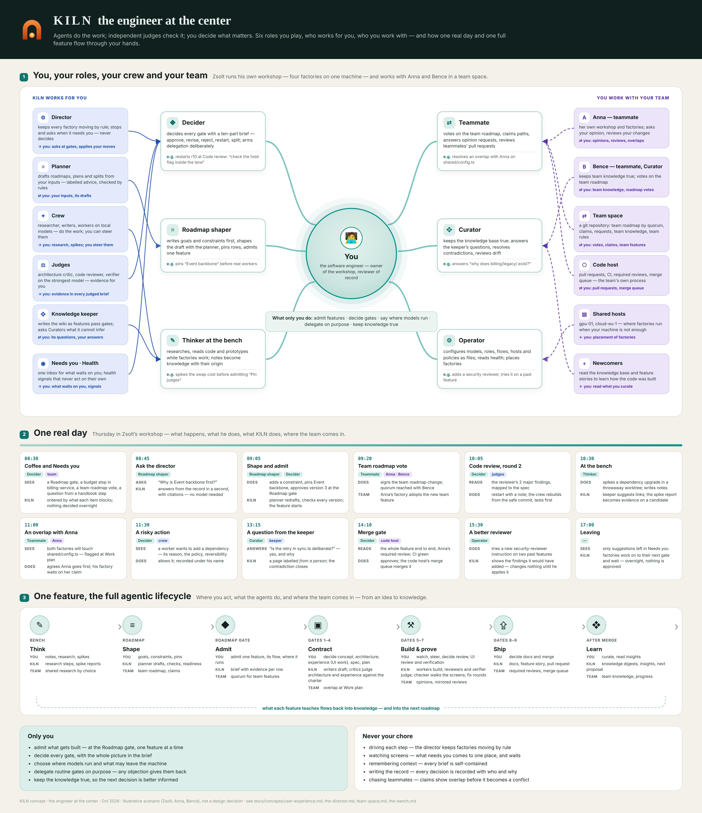
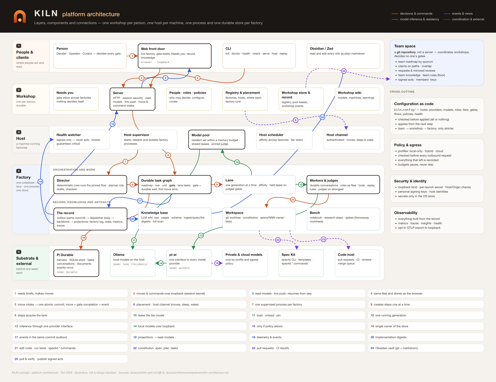
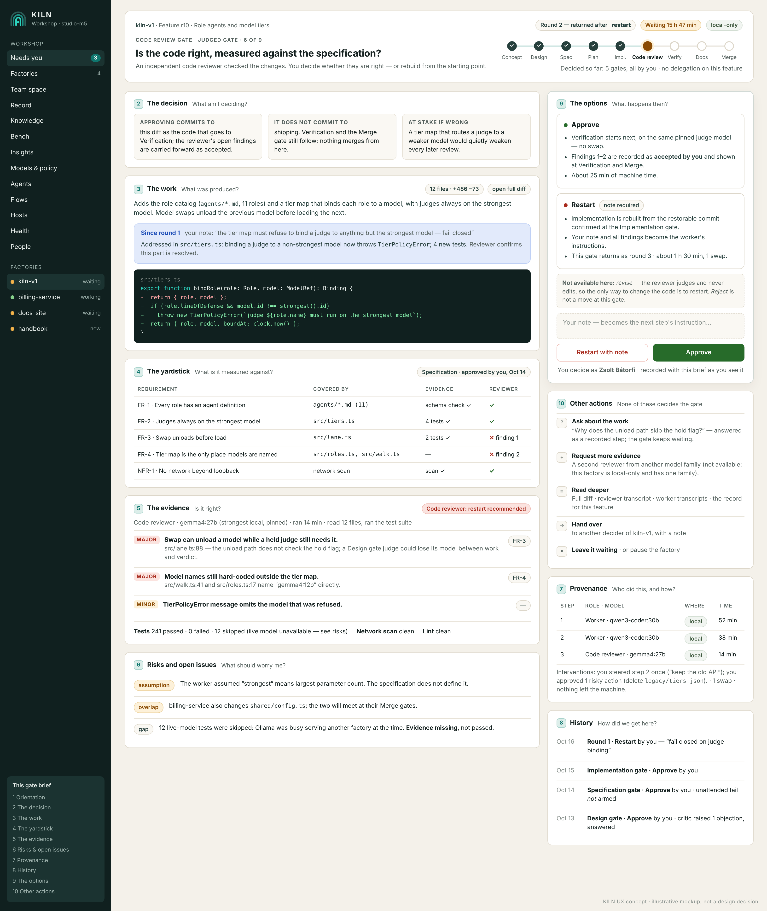

<p align="center"></p>

<p align="center"><b>A software factory you own.</b><br>
Agents research, design, write, review and verify. Independent judges check the work. <b>People decide at every gate.</b><br>
Durable, recorded, local by default — one feature at a time, in your own workshop.</p>

> **Status: design final, roadmap admitted, restart starting.** KILN is being rebuilt around a new design: a local **web front door** on
> **[Pi](https://pi.dev) and Pi Durable**, with gates as durable tasks, an event-based record, a knowledge base per factory,
> and teams of personal workshops. The concept documents, the PRD and the [constitution](./.specify/memory/constitution.md)
> (v2.1.0) were **finalized on 2026-10-21** (constitution amended 2026-10-25), with every decision that shapes `kiln-v1` made and
> [recorded](./docs/concepts/open-decisions.md). The [roadmap](./specs/ROADMAP.md) was **admitted at the Roadmap gate on 2026-10-22**
> (human@batorfi): 41 rows, r12 next. The implementation starts with r12. Since then, research snapshots of
> [models](./docs/concepts/model-landscape.md) and [dev machines](./docs/concepts/dev-machines.md) and proposals for
> [exploring codebases before adoption](./docs/concepts/code-exploration.md),
> [hybrid deployments](./docs/concepts/hybrid-deployments.md) and [KILN in the Zed editor](./docs/concepts/zed-integration.md)
> have been added (2026-10-22). What runs today is the
> **foundation from the first program** (KILN as a Pi extension), which the restart reuses. See
> [Where things stand](#where-things-stand).

<p align="center"><a href="./docs/concepts/infographic/kiln-at-a-glance.png"></a><br>
<sub>KILN at a glance — click for the full-size infographic</sub></p>

## Why KILN

AI can now write most of a feature. What it cannot do is be accountable for it. Teams adopting coding agents meet the
same problems:

- **Trust** — a model that writes code and then judges it is grading its own homework.
- **Control** — agents that run for hours make thousands of small decisions; without points where a person decides, and
  where the work genuinely stops until they do, people only review a finished pile of changes they never shaped.
- **Ownership** — cloud agents send your code and intent to someone else's servers and bill per token.
- **Collaboration** — when everyone drives their own agents, nobody can see who is building what, or how a change was
  made.

KILN's answer is a factory with a **person at every gate**, **independent judges** that never review their own work, a
substrate that is **local by default**, and a **team space** where engineers who each run their own factory see each
other's work, share what they learn and review each other's changes.

## What KILN believes

1. **Humans decide; models work.** No model approves its own work, and no missing person ever counts as a yes.
2. **Independent judges hold the line.** Architecture, code review and verification are judged by separate agents on the
   strongest available model.
3. **You decide where your models run.** Local by default; private or cloud models only for the roles you choose, under a
   policy that records everything that leaves.
4. **Work is durable.** A crash, a reboot or a closed laptop interrupts work; it never loses it — and never approves
   anything.
5. **Everything is explainable.** Every decision, model swap and gate has a recorded cause and actor.
6. **Calm, sequential work.** One feature at a time per factory, in an order that keeps the right model loaded;
   parallelism happens between factories.
7. **Your workshop is yours; the team works in the open.** Teams coordinate by making work visible — never by deciding for
   each other.

## How it works

### The flow: twelve gates, one feature at a time

A factory works on one codebase. The **Roadmap gate** admits the next feature; then the feature walks eleven gates in three
phases (two of them only where it touches the interface). At every gate a person reads a complete **gate brief** and makes a move.

| Phase | Gate | The question |
|---|---|---|
| Program | **Roadmap** | Which feature next, in what order — and how does this factory run? |
| Contract | **Concept** | Is this worth building, on these premises? |
| | **Architecture** *(judged)* | Is this the right structure? |
| | **Experience design** *(judged, interface work)* | Is this the right experience for these users and journeys, within the charter? |
| | **Specification** | What exactly counts as done? |
| | **Work plan** | In what pieces and order will it be built? |
| Build and prove | **Implementation** | Do we start from a safe point — and is this still one feature? |
| | **Code review** *(judged)* | Is the code right, measured against the specification? |
| | **UI review** *(judged, interface work)* | Does the built interface match the approved experience, and is it accessible and consistent? |
| | **Verification** *(judged)* | Does it actually work as specified? |
| Release | **Documentation** | Do the docs describe what was actually built? |
| | **Merge** | Do we ship it? |

Every move has a known consequence — *approve*, *revise*, *reject*, *restart*, *split* — and nothing moves forward on its
own: not a clock, not a restart, not a missing screen. Small features may skip Concept and Architecture; after the Specification
gate a person may delegate the routine gates, and any judge's objection ends the delegation. Teams can add gates of their
own — a threat model, a security review — without removing any. → [`the-flow.md`](./docs/concepts/the-flow.md)

### What you do

- **[Decide at the gates](./docs/concepts/user-experience.md)** — with a ten-part brief: what is being decided, the work, the yardstick, the judges' evidence,
  risks, provenance, history, and what each move would do next.
- **[Shape the roadmap](./docs/concepts/the-director.md)** — your goals and constraints first, then the planner's draft; edit, pin and decide together.
- **[Think at the bench](./docs/concepts/the-bench.md)** — a private notebook, research steps and throwaway spikes while factories work.
- **[Feed KILN anything](./docs/concepts/the-feed.md)** — drop in a note, screenshot, link or file; KILN drafts where it belongs and you decide.
- **[Curate the knowledge](./docs/concepts/factory-wiki.md)** — keep each factory's knowledge base true.
- **[Configure](./docs/concepts/configuration.md)** — hosts, models, roles, flows and policies, as plain files.
- **[Work with the team](./docs/concepts/team-space.md)** — a team roadmap, claims on code, reviews across workshops.

Everything waiting on you is in one place, **[Needs you](./docs/concepts/the-director.md)**. Nothing decides itself. You
work in the browser or the terminal — and, as proposed, inside the **[Zed editor](./docs/concepts/zed-integration.md)**,
where briefs, findings and moves sit next to the code.

<p align="center"><a href="./docs/concepts/infographic/kiln-engineer-at-the-center.png"></a><br>
<sub>The engineer at the center — your roles, your crew and your team, one real day, and one feature's full lifecycle. Click for full size.</sub></p>

### What's inside

| Part | What it does |
|---|---|
| **[Web front door](./docs/concepts/web-front-door.md)** | a local, loopback-only web app with a per-launch secret: the live factory, gate briefs, Needs you, the record |
| **[Director](./docs/concepts/the-director.md)** | deterministic orchestration of each feature's flow, with an LLM **planner** whose drafts are checked and labelled — it never decides |
| **[Durable task graph](./docs/concepts/pi-durable.md)** | built on **Pi Durable**: gates are durable tasks; a move and its gate's completion are one atomic commit |
| **[Workers and judges](./docs/concepts/configuration.md)** | roles defined as files, bound to models; judges always on the strongest model; one generation at a time per factory |
| **[Spec-driven artifacts](./docs/concepts/first-run.md)** | **[GitHub Spec Kit](https://github.com/github/spec-kit)**: the constitution, the specification, plan and tasks of every feature, versioned in the repository |
| **[The record](./docs/concepts/the-record.md)** | every state change as an event with its cause and actor — the source of live views, audits, metrics, traces and health |
| **[Knowledge](./docs/concepts/factory-wiki.md)** | an LLM-written wiki per factory and one per workshop, curated by engineers, readable as an Obsidian vault or in any editor |
| **[Health](./docs/concepts/health.md)** | watches KILN's own machinery and says plainly when something looks wrong — and never acts on its own |

<p align="center"><a href="./docs/architecture/visualisations/kiln-platform-architecture.png"></a><br>
<sub>The platform architecture — layers, components and connections. Explained in prose in the
<a href="./docs/architecture/explainers/kiln-architecture.md">architecture explainer</a>. Click for full size.</sub></p>

### Where it runs

On your machine by default — 32 GB is the minimum, 64 GB the recommended start, and a 128 GB workstation runs several
factories, one lane each ([dev machines and prices](./docs/concepts/dev-machines.md)). Factories can also run on team
servers or rented machines, placed by people at the Roadmap gate ([factories anywhere](./docs/concepts/factories-anywhere.md)).
Models are local through [Ollama](https://ollama.com) by default — which open models fill which roles on which machine is
in [the model landscape](./docs/concepts/model-landscape.md). Private or cloud models run only where a factory's policy
allows ([models beyond the machine](./docs/concepts/web-front-door.md)): for example frontier **judges** through
OpenRouter with **workers** kept local ([hybrid deployments](./docs/concepts/hybrid-deployments.md),
[routers and gateways](./docs/concepts/model-routers.md)).

### New and existing codebases

- **New codebase** — intent before code: a product brief, a constitution written from it, technology choices researched,
  spiked and decided by a person, and a **walking skeleton** first. → [`greenfield.md`](./docs/concepts/greenfield.md)
- **Existing codebase** — KILN arrives as a careful newcomer: a **full scan** of the code and its history into the
  knowledge base, a baseline of what is already broken, a territory it may change, and trust earned in stages through the
  team's own review process. → [`brownfield.md`](./docs/concepts/brownfield.md)
- **Explore first** *(proposal)* — before adopting the factory at all, KILN as a guide to existing and legacy code: maps,
  tours, answers with citations, recovered **as-is specifications** — the on-ramp for teams new to spec-driven work.
  → [`code-exploration.md`](./docs/concepts/code-exploration.md)

## What it looks like

<p align="center"><br>
<sub>A Code review gate brief — the judge's findings, the yardstick, the options and their consequences.
<a href="./docs/concepts/mockups/README.md">See all 72 mockups</a> (illustrative, not design decisions).</sub></p>

## What KILN is not

- **Not an autopilot** — nothing ships without a person's approval, live or explicitly delegated.
- **Not a hosted service** — no KILN account, no KILN backend; you run it.
- **Not a swarm** — the right agent, on the right model, one step at a time.
- **Not a control plane** — the team space coordinates; it decides no one's gates.
- **Not a replacement for engineering judgment** — it concentrates that judgment where it matters most.

## The design, document by document

All concept documents live in [`docs/concepts/`](./docs/concepts). Start with the vision; each doc below covers one area.

| Area | Document | What it covers |
|---|---|---|
| **Overview** | [What `kiln-v1` delivers](./docs/architecture/explainers/kiln-v1.md) | the release in one place: what ships, what does not, the 23 rows that build it, and when it is done |
| | [After `kiln-v1`](./docs/architecture/explainers/kiln-v1x.md) | what `kiln-v1.x` adds — cloud models, the bench, observability, factories anywhere, deeper brownfield and greenfield — and why it changes nothing built before |
| | [Decisions](./docs/concepts/open-decisions.md) | every design decision settled on 2026-10-21, and what is still open, by roadmap row |
| | [Vision](./docs/concepts/vision.md) | why KILN exists, what it believes, the human's role, the pillars, where it is going |
| | [The web front door](./docs/concepts/web-front-door.md) | the main design: Pi 1.0 and Pi Durable, the factory as a durable task graph, events, many factories, models beyond the machine |
| | [The user experience](./docs/concepts/user-experience.md) | personas, vocabulary, core experiences, the ten-part gate brief, trust and safety |
| | [KILN in Zed](./docs/concepts/zed-integration.md) | briefs, moves and knowledge inside the Zed editor — an ACP agent, an MCP server, deep links, Code review decided where the code is (proposal) |
| **The process** | [The flow](./docs/concepts/the-flow.md) | the twelve gates in depth, what runs between them, where every move leads |
| | [The interface gates](./docs/concepts/ui-flow.md) | Experience design and UI review: the two built-in gates that apply to interface work |
| | [The gate brief](./docs/concepts/the-gate-brief.md) | the ten-part brief every gate comes with: what each part answers, where its facts come from, the headline, what it must never do, and how it is recorded as seen |
| | [An extensible flow](./docs/concepts/extensible-flow.md) | gates teams add to the default flow, with the same guarantees |
| | [The experience charter](./docs/concepts/experience-charter.md) | the product's users, principles, journeys, screen map and wireframes that those gates measure against |
| | [The design system](./docs/concepts/design-system.md) | the standard structure of tokens, components and patterns the interface is built from and checked against |
| | [The director and Needs you](./docs/concepts/the-director.md) | deterministic orchestration, the planner, shaping the roadmap together, the one inbox |
| **Foundations** | [The constitution, explained](./docs/architecture/explainers/kiln-constitution.md) | the twelve principles, the flow's invariants and governance — what each rule means for the code you write |
| | [KILN on Pi Durable](./docs/concepts/pi-durable.md) | why durable tasks and conversations are the key enabler |
| | [Pi Durable tasks, explained](./docs/architecture/explainers/pi-durable-tasks.md) | what a task is, its states and commits, ownership, waiting, aborts and restarts — and the one thing a task cannot do from outside (the r42 question) |
| | [Pi Durable flows, explained](./docs/architecture/explainers/pi-durable-flows.md) | step by step: opening and resuming, one input answered, busy conversations, tools and replay, sleeping, aborting, failures — and how a KILN step and gate ride on them |
| | [The durable task graph, explained](./docs/architecture/explainers/pi-durable-task-graph.md) | the live map of unfinished tasks — owners, waits, conversations — and KILN's factory-as-a-tree built on it: roadmap, row, unit, gate and lane |
| | [The record](./docs/concepts/the-record.md) | events, the envelope, projections, replay and audit |
| | [Configuration](./docs/concepts/configuration.md) | hosts, providers, models and roles as files, checked and recorded |
| | [Health](./docs/concepts/health.md) | the watcher that observes and never acts; broken-guarantee signals |
| | [Insights](./docs/concepts/insights.md) | honest numbers about the work — evidence for people, never automatic change |
| **Knowledge and thinking** | [The factory wiki](./docs/concepts/factory-wiki.md) | an LLM-written, engineer-curated knowledge base per factory; implementation knowledge |
| | [The bench](./docs/concepts/the-bench.md) | notebook, research steps and spikes, and how they feed the roadmap |
| | [The Feed](./docs/concepts/the-feed.md) | free-form intake: drop anything in, KILN drafts where it belongs, a person decides |
| **Scale and teams** | [Factories anywhere](./docs/concepts/factories-anywhere.md) | hosts, placement, moves, sleeping hosts |
| | [The team space](./docs/concepts/team-space.md) | personal workshops on one codebase: team roadmap, claims, reviews, merging |
| **Models and machines** | [The model landscape](./docs/concepts/model-landscape.md) | open and closed models for KILN's roles, and local deployment scenarios S1–S6 (research snapshot, 2026-10) |
| | [Hybrid deployments](./docs/concepts/hybrid-deployments.md) | remote judges through OpenRouter or providers, local workers — scenarios H1–H5 on Apple silicon, with costs (proposal, needs r33) |
| | [Routers and gateways](./docs/concepts/model-routers.md) | OpenRouter, LiteLLM and other gateways — what they offer and how KILN could use them without weakening its rules (proposal) |
| | [Dev machines](./docs/concepts/dev-machines.md) | Apple silicon and Linux/PC configurations — cheap, medium, high end — with price estimates (research snapshot, 2026-10) |
| **Getting started** | [First run](./docs/concepts/first-run.md) | from install to a first Roadmap gate: models, workshop, Spec Kit, constitution, knowledge |
| | [New codebases](./docs/concepts/greenfield.md) | greenfield: product brief, decisions, walking skeleton, vertical slices |
| | [Existing codebases](./docs/concepts/brownfield.md) | brownfield: full scan into knowledge, baseline, territory, adoption in stages |
| | [Explore first](./docs/concepts/code-exploration.md) | exploring existing and legacy codebases before adopting the factory — maps, tours, recovered specs, the road into spec-driven work (proposal) |
| **Visuals** | [Mockups](./docs/concepts/mockups/README.md) · [infographics](./docs/concepts/infographic/README.md) | 72 illustrative screens; KILN at a glance; the engineer at the center |

**From the first program** — kept as history and original rationale: [the original concept](./docs/concepts/concept.md) ·
[the kiln analogy](./docs/concepts/kiln-analogy.md) · [the nine gates — why, how, what](./docs/concepts/gates-why-how-what.md) ·
[process flow](./docs/concepts/process-flow.md) · [the roadmap (Gate 0)](./docs/concepts/roadmap.md) ·
[the terminal UI layers](./docs/concepts/ui-layers-deep.md) · [role skills](./docs/concepts/skills/README.md).

## Where things stand

| | State |
|---|---|
| **The design** | **final** (2026-10-21) as concepts: [vision](./docs/concepts/vision.md), [the flow](./docs/concepts/the-flow.md), [the web front door](./docs/concepts/web-front-door.md), [user experience](./docs/concepts/user-experience.md) and companions in [`docs/concepts/`](./docs/concepts); [decisions settled and still open](./docs/concepts/open-decisions.md) |
| **The product definition** | the [PRD](./docs/prd/kiln-prd.md), **final**: principles, requirements, architecture, what to keep from today's code, milestones |
| **The law** | the [constitution](./.specify/memory/constitution.md) **v2.1.0**, amended for the restart on 2026-10-21 and for the experience charter on 2026-10-25 — [explained for engineers](./docs/architecture/explainers/kiln-constitution.md) |
| **The roadmap** | **admitted** at the Roadmap gate on 2026-10-22 by human@batorfi — [the program](./specs/ROADMAP.md) ([what `kiln-v1` delivers](./docs/architecture/explainers/kiln-v1.md)) of 41 feature-sized rows (r12–r52; `kiln-v1` is 26 of them, including the r42 spike, the team space, the explore space and Zed phase 1), `kiln-v1` at r32 — **r12 is the admitted next row** |
| **Beyond `kiln-v1`** | [what `kiln-v1.x` adds](./docs/architecture/explainers/kiln-v1x.md); proposals for [exploring codebases before adoption](./docs/concepts/code-exploration.md), [hybrid deployments](./docs/concepts/hybrid-deployments.md) and [KILN in Zed](./docs/concepts/zed-integration.md); research snapshots of [models](./docs/concepts/model-landscape.md), [routers](./docs/concepts/model-routers.md) and [dev machines](./docs/concepts/dev-machines.md) (2026-10) |
| **The code** | two trees. [`legacy/`](./legacy) is the **first program** (rows r1–r8, KILN as a Pi extension), frozen byte-for-byte and still tested. [`kiln/`](./kiln) is the **restart's codebase**, begun by row r12 (*foundations reset*): the PRD's package layout, the flow and the judge roster as versioned data (v1 the first program's rail, v2 the twelve-gate flow), the record validators, the pure affinity logic, and `kiln check` — which proves the source makes no network call, respects its package boundaries, leaves `legacy/` untouched, and (since r14) that the standard flow's data is valid. The durable core, the workers and the web front door are later rows |

The first program's roadmap and decision log are archived in
[`specs/archive/`](./specs/archive/ROADMAP-2026-09-kiln-on-pi.md).

## Try the foundation

The new KILN is not built yet. You can run and inspect the foundation the restart builds on: the new codebase's tests and checks, and the first program it keeps.

**Requirements**

- **Node.js `^22.19.0 || >=23.6.0`** — TypeScript runs directly through Node's type-stripping, with no build step. If you
  see `ERR_UNKNOWN_FILE_EXTENSION`, your Node is too old. On 22.x Node prints `ExperimentalWarning: SQLite is an experimental feature`: the durable core rests on Node's built-in SQLite, which is accepted with that warning (see [`kiln/DEPENDENCIES.md`](./kiln/DEPENDENCIES.md)). Verified on macOS only.
- **Git.** Three pinned runtime dependencies (the durable runtime and its two companions, recorded in [`kiln/DEPENDENCIES.md`](./kiln/DEPENDENCIES.md)); **one install step**: `cd kiln && npm ci` — the one network act (≈ 112 MB). `legacy/` needs no install.
- *Optional:* [Ollama](https://ollama.com) with a model for the live tier (tests default to `gemma4:12b`; set
  `KILN_LIVE_MODEL` to use another).
- *Optional:* [Pi](https://github.com/earendil-works/pi) for the Pi tier — the foundation was measured against Pi `0.85.1`
  on macOS; without Pi, those tests skip with a printed reason.

**Run it** (the npm scripts live in `kiln/`, and in `legacy/` for the first program):

```bash
git clone https://github.com/batorfi/kiln.git
cd kiln/kiln                                         # the restart's codebase
npm ci                                               # the one install step (the network act); then everything below runs offline

npm test                                             # the new suite, then the first program's (legacy) suite; the live-Pi tier skips on an unmeasured Pi, printing why
npm run check                                        # kiln check: network, boundaries, legacy, flow — each fails by name
npm run proof                                        # the proof tier (r14): every walk kill point × every hit × both walks, a re-crossing walk, a fix-round walk and 300 random kills (~3 min); the runner prints which tier ran
npm run kiln -- check flow                           # the standard flow's data, validated all-or-nothing (r14); its negative suite refuses every invalid flow
npm run validate:roadmap -- ../specs/ROADMAP.md      # the project's own roadmap, judged by its own validator
npm run validate:log -- fixtures/r7-live-inference.jsonl   # the log of a real nine-gate run (add --flow v2 to judge it under the twelve-gate flow)

# walk a feature through the twelve-gate flow from the command line (r14) — the owner opens each next gate; you only decide:
S=$(mktemp -d)/s
npm run kiln -- owner --store $S &                   # prints: listening, then ready
npm run kiln -- feature admit --store $S --key k1 --feature f1 --walk fixtures/walk-interface.json
node tests/walk/drive.ts --store $S --feature f1 --script fixtures/walk-interface.approve-all.json   # the scripted stand-in decides every gate through `kiln feature next` and `kiln gate move`

cd ../legacy                                         # the first program, frozen
npm run runtime-ready                                # readiness probes — each fails by name when something is missing
ollama pull gemma4:12b && npm run ollama-ready       # with Ollama: a real walk on a local model
npm run pi-ready                                     # with Pi: starts a real Pi and loads KILN both ways
```

Any run that executes **zero** tests fails, so a mistyped path cannot pass silently.

## Repository layout

| Path | What is in it |
|---|---|
| [`docs/concepts/`](./docs/concepts) | the design: vision, the flow, the front door, user experience, and one doc per area; research snapshots on models, routers and machines; the [decisions index](./docs/concepts/open-decisions.md) — with [mockups](./docs/concepts/mockups/README.md) and the [infographics](./docs/concepts/infographic/README.md) (KILN at a glance, the engineer at the center) |
| [`docs/architecture/`](./docs/architecture) | the [architecture explainer](./docs/architecture/explainers/kiln-architecture.md), the [constitution explainer](./docs/architecture/explainers/kiln-constitution.md), the [`kiln-v1`](./docs/architecture/explainers/kiln-v1.md) and [`kiln-v1.x`](./docs/architecture/explainers/kiln-v1x.md) explainers, and the [platform architecture infographic](./docs/architecture/visualisations/README.md) |
| [`docs/prd/`](./docs/prd/kiln-prd.md) | the product requirements for the restart |
| [`docs/brand/`](./docs/brand/README.md) | the KILN mark (nested gates) and logos |
| [`specs/`](./specs) | [`ROADMAP.md`](./specs/ROADMAP.md) (the program, admitted by a person at the Roadmap gate), [one explainer per roadmap row](./specs/explainers/README.md), one directory per feature with its spec, plan, tasks and evidence, and the archived first program |
| [`kiln/`](./kiln) | the restart's codebase (row r12 onward): `packages/` (contracts, record, lane, and the empty places of the rest, each with a `kiln.json` stating its single responsibility), `checks/` (the network lint, package boundaries, legacy identity and flow check behind `kiln check`), `tests/` (the runner for both suites) and the committed fixtures of real runs |
| [`legacy/`](./legacy) | the first program's whole tree (rows r1–r8: runtime, gate and log machinery, validators and probes, the Pi extension, tests), **frozen** byte-for-byte and proven so by `kiln check legacy`; retired when each part is ported. Older specs and reports name its files as `kiln/…` — read that as `legacy/…` |
| [`.specify/`](./.specify), [`.pi/`](./.pi) | the Spec Kit scaffolding and Pi prompts the project is built with, and KILN's constitution |

## How the project is built

KILN is built by the process it describes: **spec-driven**, with Spec Kit on Pi, under its
[constitution](./.specify/memory/constitution.md). The program is a roadmap of rows; each row is one feature through the
gates, and **a person admits the program at the Roadmap gate and re-admits it between rows**. Each finished row leaves its
evidence next to its spec — for an example, read the [overview of r7](./specs/006-kiln-live-inference/overview.md), its
[verification report](./specs/006-kiln-live-inference/verification-report.md) and its
[code review report](./specs/006-kiln-live-inference/code-review-report.md), which record what was found wrong as well as
what was right.

## Read next

1. [Vision](./docs/concepts/vision.md) — why KILN exists and where it is going
2. [KILN at a glance](./docs/concepts/infographic/kiln-at-a-glance.png) — the whole concept on one page
3. [The engineer at the center](./docs/concepts/infographic/kiln-engineer-at-the-center.png) — the user experience on one page: roles, a real day, the full lifecycle
4. [The flow](./docs/concepts/the-flow.md) — the twelve gates, gate by gate
5. [The user experience](./docs/concepts/user-experience.md) — what working with KILN is like, and the gate brief
6. [Platform architecture](./docs/architecture/visualisations/kiln-platform-architecture.png) and the [architecture explainer](./docs/architecture/explainers/kiln-architecture.md) — how KILN is built, and why
7. [The web front door](./docs/concepts/web-front-door.md) — the design on Pi Durable, events and the record
8. [First run](./docs/concepts/first-run.md) — from install to a first Roadmap gate
9. [What `kiln-v1` delivers](./docs/architecture/explainers/kiln-v1.md) and [the constitution, explained](./docs/architecture/explainers/kiln-constitution.md) — the release and the rules it keeps
10. [The PRD](./docs/prd/kiln-prd.md), [the admitted roadmap](./specs/ROADMAP.md) and [one explainer per roadmap row](./specs/explainers/README.md)
11. [Dev machines](./docs/concepts/dev-machines.md), [the model landscape](./docs/concepts/model-landscape.md) and [hybrid deployments](./docs/concepts/hybrid-deployments.md) — what to run KILN on

## Contributing

There is no formal contribution process yet. Issues and questions are welcome. Because design decisions here go through
human gates, a proposal is best raised as an issue before any code.

## License

KILN is licensed under the [Apache License 2.0](./LICENSE). Copyright 2026 Zsolt Bátorfi — see [`NOTICE`](./NOTICE).

The Spec Kit scaffolding under `.specify/` and `.pi/` is © GitHub, Inc. under the MIT License; see
[`THIRD-PARTY-NOTICES.md`](./THIRD-PARTY-NOTICES.md).
