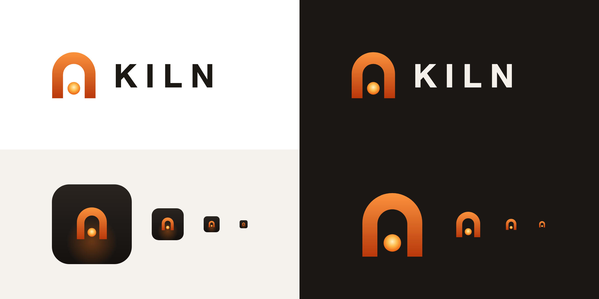

# KILN logo

**The idea.** One arch — the kiln's chamber, open at the base — holding one ember. It is KILN's thesis in a single
shape: *one chamber, one batch, held heat*. The arch also reads as a gate, the place where the work stops for a
human.

| File | Use |
|---|---|
| [`kiln-mark.svg`](kiln-mark.svg) | the mark alone — app chrome, small spaces (works down to 16 px) |
| [`kiln-logo.svg`](kiln-logo.svg) | mark and wordmark, for light backgrounds |
| [`kiln-logo-dark.svg`](kiln-logo-dark.svg) | mark and wordmark, for dark backgrounds |
| [`kiln-icon.svg`](kiln-icon.svg) | app icon and favicon — the mark on a dark rounded square |

**Colours.** Shell: `#FB923C` → `#B8380B` (top to bottom). Ember: `#FFF1C2` → `#FDBA4A` → `#EA580C` (centre outwards).
Wordmark: `#1C1814` on light, `#F5F0EA` on dark — the same inks as the UX mockups.

**Wordmark.** `KILN` in a bold system sans, letter-spaced. The SVG uses live text with a system font stack; outline
it before using the logo anywhere fonts cannot be relied on.

**Keep it simple.** Don't add a flame, a border or a tagline to the mark; don't recolour the ember; leave clear space
around the mark of at least the width of the ember.

## GitHub images

| File | Size | Use |
|---|---|---|
| `kiln-social-preview.png` | 1280 × 640 | the repository's **social preview** (Settings → General → Social preview) |
| `kiln-avatar.png` | 512 × 512 | a square **avatar** — the mark on the dark background, for a profile or organisation picture |

GitHub's API cannot set either image; both are uploaded by hand in GitHub's settings.
