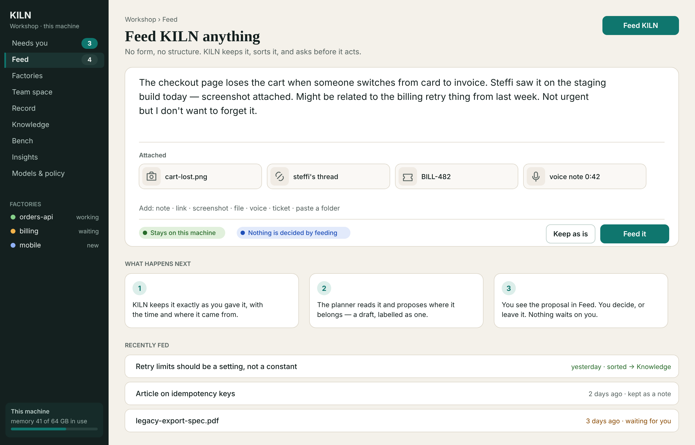
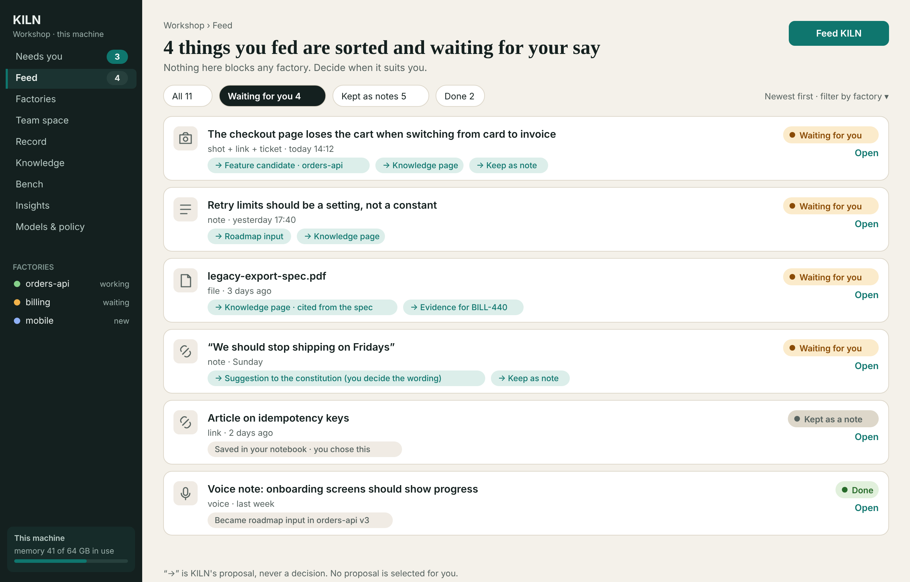
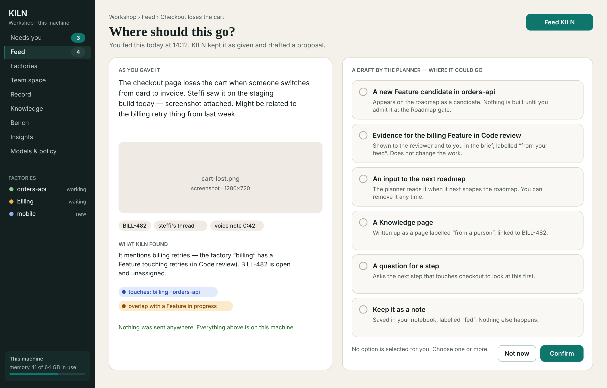
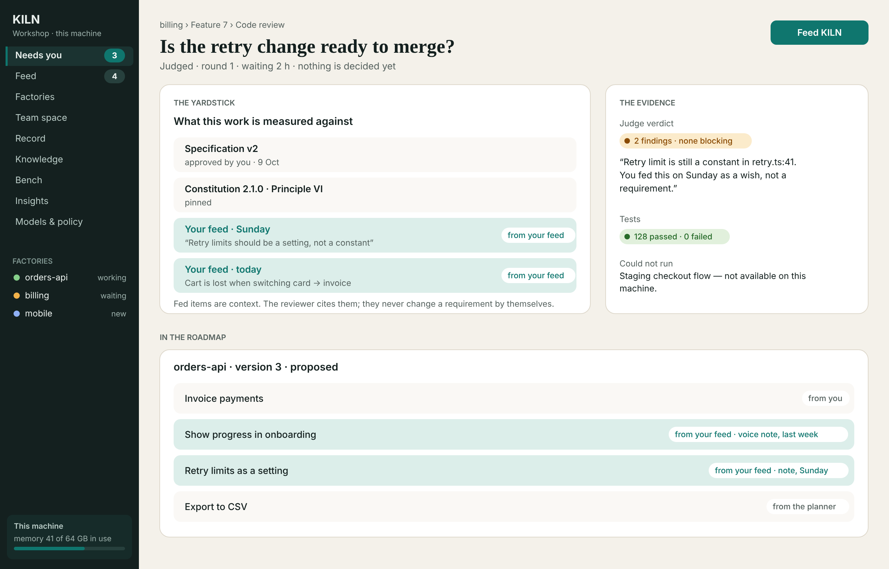

> Status: concept — **proposal** (2026-10-25, for human@batorfi to review; rev 2). Building it is admitted only at the Roadmap gate.
> Type: concept
>
> Scope note: this doc describes **the Feed** — one free-form place to give KILN anything (a thought, a screenshot, a link, a
> file, a voice note, a ticket) without deciding where it belongs — and how KILN sorts it, proposes destinations, and leaves
> every decision to a person. It covers what can be fed, how it is captured, what the sorting step does and does not do, where
> an item can go, how it is traced afterwards, and how it fits KILN's rules. It is a concept, not a design or a spec.
>
> Companion docs:
>   - Working with KILN:          `the-director.md` (§4, Needs you)
>   - The bench and notebook:     `the-bench.md`
>   - Knowledge:                  `factory-wiki.md`
>   - The roadmap:                `roadmap.md`, `the-director.md` §4.3
>   - The charter and the design system: `experience-charter.md`, `design-system.md`
>   - The record:                 `the-record.md`
>   - Teams:                      `team-space.md`
>   - The user experience:        `user-experience.md` (§7.17a)
>   - The PRD:                    `../prd/kiln-prd.md` (FEED-1…7)
>   - Illustrations:              `feed/` (SVG source and PNG; drawn in the teal-and-sand theme)

# KILN — the Feed

## 1. In one paragraph

KILN takes direction in structured places: a roadmap brief, a gate note, a knowledge page. Real ideas do not arrive that
way — they arrive as half a sentence, a screenshot of a bug, a ticket link, a voice note on the way home, an old PDF.
**The Feed** is one place to drop any of it, as it is. KILN **keeps it exactly as given**, a labelled planner step **drafts
where it could go and what it found**, and the engineer **decides** — or leaves it. Feeding decides nothing, blocks nothing,
sends nothing off the machine, and costs the person one deliberate act.

## 2. Why

- **Ideas have no address.** At 14:12 you do not know whether a bug is a feature candidate, evidence for a gate in review, a
  knowledge page, or a note. Forcing the choice at capture means either dropping the idea or choosing badly.
- **The bench is for thinking; the Feed is for telling.** The notebook is private, unruled and not read by anyone else
  (`the-bench.md` §3). The Feed is *addressed to KILN*: it is meant to be read, sorted and, if you choose, acted on. They are
  different acts and keep different guarantees (§9).
- **Direction should be cheap and safe.** If giving KILN a hint could silently change a requirement, people would stop
  hinting. The Feed's whole design is that it cannot — only the person's later, recorded choice has any effect.

## 3. Principles

| | Principle | What it means |
|---|---|---|
| **F1** | **Free of form** | nothing is required: no type, factory, title or template; text, links, screenshots, files, voice, tickets, folders |
| **F2** | **Original kept, untouched** | the thing fed is stored exactly as given, with time and source, and is never rewritten; edits are new versions |
| **F3** | **Nothing is decided by feeding** | a fed item is evidence or a wish — never a requirement, an approval, a move or a rule; it cannot change an artifact by itself |
| **F4** | **KILN proposes, a person chooses** | proposals are drafts, labelled as such, with what each would do; none is pre-selected; zero, one or several may be chosen; *keep as a note* and *not now* always exist |
| **F5** | **Quiet** | the Feed has its own count beside *Needs you*; it never blocks a factory, never escalates, never expires, never notifies by itself |
| **F6** | **Local, scanned, policy-bound** | capture and storage are on this machine; secrets are scanned on capture; the sorting step follows the workshop's egress policy like any other step |
| **F7** | **A trail, not a pile** | every use of a fed item shows *from your feed* and links to the original; the original lists where it went |
| **F8** | **Personal by default** | a fed item belongs to its person; sharing with a team is a separate, explicit act |

## 4. What can be fed

| Kind | Examples | What KILN keeps | What the sorting step may extract |
|---|---|---|---|
| **Text** | a sentence, a paragraph, a pasted thread | the text as given | gist, mentioned factories, files, ticket ids |
| **Link** | an issue, a pull request, an article | the URL, plus a snapshot of the page **only if egress policy allows a fetch** | title, ids; otherwise nothing is fetched |
| **Screenshot / image** | a bug, a design, a whiteboard | the image | text via local OCR; a description if a local model that can read images is resident (the model catalog says whether) |
| **File** | a PDF, a spec, a log, a CSV | the file (size-capped, configurable) | text, headings, ids; for code or logs, the paths and error lines |
| **Voice** | a note recorded on a phone or in the browser | the audio | a transcript — **local transcription only** unless a hybrid model is explicitly configured |
| **Ticket** | a tracker reference (via a connector, when one exists) | the reference and the fields read | title, status, links |
| **Folder** | a directory of files | a manifest and the files (capped) | a short summary per file |
| **Several of the above together** | the cart bug: text + screenshot + ticket + voice note | one item with its parts | treated as one thing |

An item is **one fed thing** however many parts it has. Duplicates (the same content hash) are recognised and shown as one
item with two feeds.

## 5. Capturing

There is one global action, **Feed KILN**, wherever the person is:

- **web front door** — the button in the page header (visible on every screen), drag-and-drop anywhere, paste;
- **terminal** — `kiln feed "text"`, `kiln feed ./cart-lost.png`, piped input (`some-command | kiln feed`);
- **editor** — *send to KILN* with the selection, its file, lines and commit (same shape as *send to notebook*);
- **phone / other devices** — through the web front door when it is reachable (`factories-anywhere.md`), including voice;
- **a watched inbox folder** — **off by default**; when the person turns it on, files dropped into it are fed (a deliberate,
  standing choice, shown in *Models & policy → Changes*).

Capture is **one deliberate act** and nothing is ever fed without it — KILN never reads a clipboard, a mailbox or a chat on
its own. Capture is instant and works with no model running: the item is stored, hashed, scanned for secrets, and queued for
sorting. If a secret is found, the item is kept but marked, and the sorting step is told to treat it as local-only.

## 6. Sorting

Sorting turns a raw item into a **proposal**: a gist, a list of findings, and drafted destinations. It has two parts, kept
apart for the usual reason (`the-director.md` §2): rules for what can be known mechanically, a model for what needs judgment.

| Part | Done by | What it does |
|---|---|---|
| **Intake** | deterministic code | store, hash, deduplicate, detect kind, scan for secrets, extract text with local tools (OCR, PDF text), recognise ticket ids and file paths |
| **Matching** | deterministic code | which factories the item mentions or touches (names, paths, ids), whether a claim or a feature in progress overlaps, whether a ticket or knowledge page already exists |
| **Proposal** | the **planner**, an ordinary visible step | writes the gist, drafts the destinations and their wording (for example the text of a feature candidate), explains why; **output is labelled a draft and checked by rules** (it may only name destinations from the closed list in §7, and only cite things that exist) |

**Where it runs.** Sorting is a **workshop-level** step — like the wiki keeper's work, it is not a step of any factory and does
not hold a factory's lane. It leases the model pool at the **lowest priority**, never preempts a judged step, and waits when the
host is busy (the item shows *sorting soon*). A factory in a **local-only** profile sorts with local models; a **hybrid**
factory's items may use a configured cloud model only where egress policy allows, and an item flagged with a secret never does.

**What sorting never does:** change anything outside the Feed; call any tool; write to knowledge, the roadmap, a brief or a
gate; contact anyone; decide anything. Its only output is the draft proposal, stored beside the item.

## 7. Where an item can go

The destinations are a **closed list**. Each has a fixed, stated consequence, and each is chosen by the person.

| Destination | What is created | Where it appears | Who decides further | Taking it back |
|---|---|---|---|---|
| **Feature candidate** | a candidate on the factory's candidate list, with the item as its evidence and a readiness estimate | the bench's candidate list; the Roadmap gate brief | the engineer, at the Roadmap gate — admission is **never** automatic | remove the candidate; the item returns to *waiting* |
| **Input to the next roadmap** | a line in the roadmap brief the planner reads | the Roadmap gate's *your inputs*, marked *from your feed* | the engineer shapes and decides the roadmap | remove the input |
| **Evidence for a gate** | a link attached to a named gate of a named feature | that gate's brief, in the yardstick or evidence, labelled *from your feed*; the judge may cite it | the engineer decides the gate; the item is **context, never a requirement** | unlink |
| **Knowledge page** | a page **drafted** by a step, labelled *from a person*, citing the item | the tier the person chose (workshop, factory, team — the last needs its own curator path) | a Curator, if the tier needs one; otherwise the engineer | the page is an ordinary page: edit or delete it as any page |
| **Question for a step** | a note added to the next matching step's context | the step's brief, labelled | none — it is information for that step | remove before the step starts |
| **Suggestion to the constitution, charter or design system** | a **suggestion** addressed to the named owner(s), carrying the item | the owners' *Needs you*, as *worth knowing* | **only the named owner writes and approves any change**, by the owners' usual path | withdraw the suggestion |
| **Keep as a note** | a note in the person's **notebook**, labelled *fed*, exactly as given | the bench; the Feed shows it under *Kept as notes* | nobody; it is private thinking | delete the note |
| **Not now** | nothing | the item stays *waiting* | — | — |

A person may choose **several** destinations for one item. Each choice is its own recorded act. Routing never asks "are you
sure?" for a reversible destination, and always says what it will do first (§11).

## 8. The life of an item

```
fed ──► kept & scanned ──► sorting soon ──► sorted (waiting for you) ──► routed ──► used ──► done
             │                                     │                        │
             └─ could not be sorted (reason) ──────┴── kept as a note / not now / dismissed
```

| State (shown as a word and a shape) | Meaning |
|---|---|
| **Sorting soon** | stored and queued; sorting waits for the host |
| **Waiting for you** | sorted; a proposal is ready; nothing has happened |
| **Kept as a note** | a person chose to keep it; it is in the notebook |
| **Routed** | one or more destinations were chosen; they are listed with their state |
| **Done** | every chosen destination has been consumed (the candidate was admitted or dropped, the gate decided, the page written) |
| **Could not be sorted** | sorting failed (no model, unreadable file, policy); the item is kept and the reason shown; the person can route by hand |
| **Dismissed** | the person removed it from the list; it stays in the record |

Nothing leaves a state on its own except *sorting soon → waiting for you / could not be sorted*. **Waiting never times out and
never escalates.**

## 9. The Feed and the notebook

| | The notebook (`the-bench.md`) | The Feed |
|---|---|---|
| Purpose | **thinking** — fragments, sketches, reading notes | **telling** — an idea or evidence for KILN to sort |
| Audience | the author only | KILN's sorting step, then whoever the person routes it to |
| Rules | none: no schema, no lint, no findings | an item is immutable; proposals are drafts; destinations are a closed list |
| Read by KILN | lightly, at lowest priority, to suggest | always sorted; the proposal is shown |
| Crosses over | *Send to the Feed* from a note (an explicit act) | *Keep as a note* puts the item in the notebook, labelled *fed* |

Feeding is never a way around the notebook's privacy: **the sorting step never reads the notebook**, and a note is only
read as a Feed item when its author sends it.

## 10. Trail and provenance

- Every use of a fed item — a candidate, a roadmap line, a gate's evidence, a knowledge page, a step's question — carries a
  **from your feed** label and a link to the original; the Roadmap gate brief marks each row's origin (*from you*, *from your
  feed*, *from the planner*; `the-director.md` §4.3).
- The original shows **where it went**: each destination, who chose it, when, and its present state.
- A **gate brief** shows fed evidence in the yardstick or evidence part, never in the author's context unmarked. For the
  independence rule (`constitution` Principle II): a judge may cite a fed item only when the person routed it as evidence, and
  the brief shows that.
- The **feature record** lists the fed items that touched the feature, with who routed them (`the-record.md`).

## 11. What the person sees

*(The illustrations are in `feed/`; the full screen is **S19 Feed** in the experience charter.)*

| | |
|---|---|
|  |  |
| **A. Drop anything.** One big box, any attachments, and two reassurances: it stays on this machine, and nothing is decided by feeding. | **B. The Feed.** Everything fed, with state in words and drafted destinations marked "→" — text, not controls. |
|  |  |
| **C. Where should this go?** The original beside a labelled draft; what KILN found; six destinations, none selected. | **D. The trail.** In a gate brief's yardstick and in the roadmap, fed items are visibly *from your feed*. |

Three behaviours the screens guarantee:

1. **The original is always one click away** and always shown as given.
2. **Each destination says what it will do before it does it**, and says how far back it can be taken.
3. **The Feed count in the rail never competes with Needs you** — it is a different, quieter number, and an item in it is never described as blocking.

## 12. Events and the record

| Event | When | Carries |
|---|---|---|
| `feed.captured` | an item is fed | item id, kinds, sizes, content hashes, source surface, secret-scan result |
| `feed.sorted` | a proposal is ready | item id, the planner step, the model and where it ran, the drafted destinations and findings |
| `feed.sort_failed` | sorting could not finish | item id, reason |
| `feed.routed` | the person chooses a destination | item id, destination, target (candidate / roadmap / gate / page / step / owner), **actor** |
| `feed.unrouted` | the person takes a destination back | item id, destination, actor |
| `feed.kept` · `feed.dismissed` | the person keeps it as a note or dismisses it | item id, actor |
| `feed.edited` | the author edits an item | item id, new version hash (the old version stays) |

Events follow the usual rules: they name the actor, are committed with the effect they describe, are immutable, and are
shown in the feature record where they touched a feature. Item **content** lives in the workshop store beside the record
(`~/kiln/feed/<item>/` — originals, extracted text, the draft proposal), not in the event stream; the events carry hashes.
The store is **private to the workshop** and not synced, shared or published unless the person shares an item (§13).

## 13. In a team

- The Feed is **personal**. Other members never see a person's items, proposals or counts.
- **Share to the team** is an explicit act on one item: it publishes the item, as given, to the team space (a request,
  *opinion wanted*, or a candidate for the team roadmap) at a publishing level the person chooses
  (`team-space.md`). Sharing a candidate does not admit it — the team roadmap is decided by quorum.
- A **suggestion to the constitution, charter or design system** goes to the **named owners**; in a team, those foundations are
  the repository's files changed only by a pull request their owners approve (`team-space.md` §11a). The Feed only opens the
  suggestion; it never edits those files.
- An item that mentions a teammate's claim or factory shows the overlap in the proposal, so the person sees it **before**
  routing — the same overlap rule as in briefs.

## 14. Failure and edge cases

| Situation | What happens |
|---|---|
| No model is resident or the pool is full | the item is stored and shown *sorting soon*; routing by hand is possible meanwhile |
| A file is too large or of an unsupported type | kept as given up to the cap; otherwise refused with the reason and the cap, nothing partially stored |
| A secret is found | the item is kept, marked, never sent to a cloud model; the person is told what kind of match, not the secret |
| The same thing fed twice | recognised by hash; shown as one item with two feeds |
| A link needs a fetch the policy blocks | the URL is kept, the proposal says the page was not read, and why |
| A destination's target is gone (the factory was archived, the gate decided) | the proposal for that destination is withdrawn; the item returns to *waiting* |
| The planner proposes something outside the closed list or cites something that does not exist | rejected by the rules check; the item is shown as *could not be sorted* with the reason |
| The person feeds ten things in a row | each is separate; sorting is batched at the lowest priority; the Feed shows progress, not a flood of notifications |

## 15. How it fits KILN's rules

| Principle | How the Feed honours it |
|---|---|
| **I · Author / judge separation, a person decides** | feeding adds no producer, no judge and no deciding move; routing is a person's recorded choice; proposals are labelled drafts |
| **II · Independent judges on the strongest model** | fed items reach a judge only as evidence a person routed, labelled; judges are not weakened or bypassed |
| **III · One lane per factory** | sorting is a workshop-level step at the lowest priority; it holds no factory lane and never preempts a judged step |
| **VII · The record** | every capture, sort, route and un-route is an event naming its actor |
| **VIII · Local by default** | capture and storage are local; sorting follows the egress policy; secrets never leave; links are fetched only if policy allows |
| **Roadmap gate is human-only** | a fed item may become a candidate or an input; admission is still the gate |
| **Experience charter X1, X7, X9** | no decisions by the screen; quiet by default; the person can always step in |

## 16. Experience charter and design system impact

- **Charter (MINOR when approved):** new screen **S19 Feed** (list, filters, item page — illustrations B and C), a global **Feed KILN** action
  in the frame (S0), journey **J13 Feed an idea** (J13.1 drop it · J13.2 see the proposal · J13.3 choose where it goes · J13.4 see it
  used), interaction pattern **P8 Proposal, not decision**. All are already in the draft charter.
- **Design system:** components `C:feed-item` and `C:button`, pattern `P:proposal-not-decision`, the Feed nav item with its own
  count; no new tokens.
- **Gates:** no gate is added or changed. The Roadmap gate brief gains the *from your feed* origin; gate briefs gain it on fed evidence.

## 17. Proposed requirements

The PRD has FEED-1 to FEED-4 (§6.24); this concept proposes three more.

| ID | Requirement | Priority |
|---|---|---|
| FEED-5 | **Take it back**: every reversible destination can be taken back (`feed.unrouted`), and the item returns to *waiting*. | Should |
| FEED-6 | **Share to the team** is an explicit act on a single item and never changes a team artifact by itself. | Could |
| FEED-7 | **Watched inbox folder** and capture from other surfaces (editor, phone) are opt-in and listed in *Models & policy → Changes* when turned on. | Could |

## 18. Where it lands in the program

It is part of `kiln-v1` (decided 2026-10-25), as roadmap row **r53**, after the front door and the factory knowledge it routes into
(r22, r24). Its Musts are FEED-1…5: capture, drafted destinations, routing by a person, the trail and take-back. In `kiln-v1` the
planner offers only the destinations the build has — roadmap input, gate evidence, knowledge page, question for a step,
suggestions to the constitution, charter and design system, and *not now*. **Row r54** (`kiln-v1.x`, after the bench) adds the
destinations that need it — *keep as a note* in the notebook and *feature candidate* — plus sharing a single item to the team and
the watched inbox (FEED-6, 7). Both rows are admitted at the Roadmap gate; the program re-opens there to take them.

## 19. Open questions

- **Q1 · Voice:** local transcription only, or may a configured hybrid model transcribe when egress allows?
- **Q2 · Retention:** the record never forgets; may the author **redact** an item's content (keeping hashes and a tombstone) — and does that need a team rule?
- **Q3 · Ticket connectors:** which trackers first, and are they read-only (recommended)?
- **Q4 · Capture from outside:** how does a phone feed a workshop that is not reachable (queue on the device and send later)?
- **Q5 · Batching:** should sorting wait for an idle host by default, or sort at once on a small local model when one is resident?
- **Q6 · Sharing:** should *share to the team* ever be offered as a default for items that mention a teammate's claim?

## 20. Sources

KILN's own concepts and mockups; the experience charter's principles X1–X10; the bench's notebook rules; the director's *Needs
you* and proposals. No external sources.

## 21. One sentence

**The Feed is one place to tell KILN anything, as it is — kept untouched, sorted into drafted destinations, and acted on only
when a person chooses.**
