# The roadmap, row by row — explainers

> One explainer per row of the [roadmap proposal](../ROADMAP.md): the row's **focus**, what it **delivers**, **why** it
> exists, **why it sits where it does**, what it builds on, how it is **proven**, what it leaves out, the **decisions** it
> waits on, and its **risks**. Written for understanding; the roadmap and the [PRD](../../docs/prd/kiln-prd.md) govern.
> The roadmap is a proposal pending the Roadmap gate — nothing here is admitted.

## How to read the roadmap

- **One row is one feature** walked through all ten gates; rows run one at a time and start only when their dependencies
  are done.
- **Rows r12–r32 are `kiln-v1`**; rows r33–r42 follow as `kiln-v1.x` and change nothing built before them.
- **Ids continue from r12** because r1–r11 belong to the first program (archived in [`../archive/`](../archive/ROADMAP-2026-09-kiln-on-pi.md)).
- **Pending decisions** that can change rows: the flow proposals (r14, r20), the broken-guarantee response (r27) and
  `kiln-v1` scope — option B would move r26 and r29 after the release.

## Rows

| Row | Phase | Feature | In one line | Release |
|---|---|---|---|---|
| [r12](r12-foundations-reset.md) | Foundation | **Foundations reset** | new layout, legacy frozen, kept code ported with its tests, three-platform CI | kiln-v1 |
| [r13](r13-durable-core.md) | Durable core | **Durable core and the gate contract** | the Pi Durable seam and the gate contract — nothing approves by absence | kiln-v1 |
| [r14](r14-gates-as-data.md) | Durable core | **Gates as data, walked headless** | the default flow as data; a scripted feature walks all ten gates headless | kiln-v1 |
| [r15](r15-the-record.md) | Durable core | **The record** | events committed with every change; the factory-log rebuilt byte for byte | kiln-v1 |
| [r16](r16-real-local-workers.md) | Workers | **Real local workers** | durable conversations on local models; replay rules; the model pool | kiln-v1 |
| [r17](r17-configuration-as-files.md) | Workers | **Configuration as files** | roles, tier map and policies as checked, recorded files | kiln-v1 |
| [r18](r18-the-director.md) | Director | **The director** | deterministic orchestration with a checked planner | kiln-v1 |
| [r19](r19-web-front-door-read-only.md) | Front door | **Web front door, read-only** | see every factory and the record in a browser, securely | kiln-v1 |
| [r20](r20-gates-on-the-web.md) | Front door | **Gates on the web** | decide every gate in the browser with the ten-part brief; Needs you | kiln-v1 |
| [r21](r21-stepping-in.md) | Front door | **Stepping in** | delegation, steering and risky-action approvals — none settles a gate | kiln-v1 |
| [r22](r22-shaping-the-roadmap-together.md) | Front door | **Shaping the roadmap together** | the engineer's inputs, a planner conversation, pins and versions | kiln-v1 |
| [r23](r23-factory-knowledge-base.md) | Knowledge | **The factory knowledge base** | an LLM wiki per factory, readable in Obsidian, cited in briefs | kiln-v1 |
| [r24](r24-implementation-knowledge-and-workshop-wiki.md) | Knowledge | **Implementation knowledge and the workshop wiki** | the factory explains its own code; a shared workshop wiki | kiln-v1 |
| [r25](r25-one-workshop-several-factories.md) | Workshop | **One workshop, several factories** | several factories, a shared model pool, one Needs you | kiln-v1 |
| [r26](r26-agents-and-flows.md) | Workshop | **Agents and flows** | role try-runs, added gates and flows chosen per feature | kiln-v1 |
| [r27](r27-health-and-broken-guarantees.md) | Workshop | **Health and broken guarantees** | the watcher that observes, never acts; broken guarantees are critical | kiln-v1 |
| [r28](r28-first-run.md) | Getting started | **First run** | install to a first Roadmap gate in under an hour, with Spec Kit and a constitution | kiln-v1 |
| [r29](r29-new-codebases.md) | Getting started | **New codebases** | product brief, recorded decisions, a walking skeleton first | kiln-v1 |
| [r30](r30-existing-codebases-scan.md) | Getting started | **Existing codebases, part 1: profile and full scan** | profile and full scan of code and history into knowledge | kiln-v1 |
| [r31](r31-existing-codebases-baseline-territory.md) | Getting started | **Existing codebases, part 2: baseline, territory, process** | what is already broken, where KILN may change things, the team's process | kiln-v1 |
| [r32](r32-kiln-v1-release.md) | Release | **Cut the kiln-v1 release** | installer, docs, demo — accepted on all three platforms | kiln-v1 |
| [r33](r33-models-beyond-the-machine.md) | kiln-v1.x | **Models beyond the machine** | catalog, profiles, routing, egress policy, budgets | kiln-v1.x |
| [r34](r34-bench-notebook-and-research.md) | kiln-v1.x | **The bench, part 1: notebook and research** | private notebook, keeper suggestions, cited research | kiln-v1.x |
| [r35](r35-bench-spikes-and-candidates.md) | kiln-v1.x | **The bench, part 2: spikes and candidates** | measured spikes and roadmap evidence | kiln-v1.x |
| [r36](r36-observability-in-full.md) | kiln-v1.x | **Observability in full** | traces, insights, time travel, a feature's journey | kiln-v1.x |
| [r37](r37-factories-anywhere.md) | kiln-v1.x | **Factories anywhere** | hosts, placement, moves, sleeping hosts | kiln-v1.x |
| [r38](r38-team-space-foundations.md) | kiln-v1.x | **Team space, part 1** | a signed git repository, the team floor, a team roadmap by quorum | kiln-v1.x |
| [r39](r39-team-space-collaboration.md) | kiln-v1.x | **Team space, part 2** | claims, cross-workshop reviews, team-aware merge, team knowledge | kiln-v1.x |
| [r40](r40-existing-codebases-the-rest.md) | kiln-v1.x | **Existing codebases, the rest** | preserved behaviour, adoption stages, rehearsal, re-scans | kiln-v1.x |
| [r41](r41-new-codebases-the-rest.md) | kiln-v1.x | **New codebases, the rest** | conventions, slices, growing into brownfield, starting as a team | kiln-v1.x |
| [r42](r42-devices-and-remote-work.md) | kiln-v1.x | **Devices and remote work** | paired devices over private networks, step-up, offline, continuity | kiln-v1.x |

## Dependencies

```mermaid
flowchart LR
  r12["r12 · Foundations reset"]
  r13["r13 · Durable core and the gate contract"]
  r14["r14 · Gates as data, walked headless"]
  r15["r15 · The record"]
  r16["r16 · Real local workers"]
  r17["r17 · Configuration as files"]
  r18["r18 · The director"]
  r19["r19 · Web front door, read-only"]
  r20["r20 · Gates on the web"]
  r21["r21 · Stepping in"]
  r22["r22 · Shaping the roadmap together"]
  r23["r23 · The factory knowledge base"]
  r24["r24 · Implementation knowledge and the workshop wiki"]
  r25["r25 · One workshop, several factories"]
  r26["r26 · Agents and flows"]
  r27["r27 · Health and broken guarantees"]
  r28["r28 · First run"]
  r29["r29 · New codebases"]
  r30["r30 · Existing codebases, part 1: profile and full scan"]
  r31["r31 · Existing codebases, part 2: baseline, territory, process"]
  r32["r32 · Cut the kiln-v1 release"]
  r33["r33 · Models beyond the machine"]
  r34["r34 · The bench, part 1: notebook and research"]
  r35["r35 · The bench, part 2: spikes and candidates"]
  r36["r36 · Observability in full"]
  r37["r37 · Factories anywhere"]
  r38["r38 · Team space, part 1"]
  r39["r39 · Team space, part 2"]
  r40["r40 · Existing codebases, the rest"]
  r41["r41 · New codebases, the rest"]
  r42["r42 · Devices and remote work"]
  r12 --> r13
  r13 --> r14
  r14 --> r15
  r13 --> r16
  r15 --> r16
  r16 --> r17
  r14 --> r18
  r17 --> r18
  r15 --> r19
  r18 --> r20
  r19 --> r20
  r20 --> r21
  r20 --> r22
  r20 --> r23
  r23 --> r24
  r20 --> r25
  r18 --> r26
  r25 --> r26
  r19 --> r27
  r15 --> r27
  r17 --> r28
  r22 --> r28
  r23 --> r28
  r26 --> r29
  r28 --> r29
  r24 --> r30
  r28 --> r30
  r30 --> r31
  r21 --> r31
  r21 --> r32
  r24 --> r32
  r26 --> r32
  r27 --> r32
  r29 --> r32
  r31 --> r32
  r32 --> r33
  r32 --> r34
  r34 --> r35
  r32 --> r36
  r32 --> r37
  r37 --> r38
  r38 --> r39
  r31 --> r40
  r35 --> r40
  r29 --> r41
  r35 --> r41
  r39 --> r41
  r32 --> r42
  r37 --> r42
  classDef v1x fill:#F4EFFD,stroke:#D9C9F6;
  class r33,r34,r35,r36,r37,r38,r39,r40,r41,r42 v1x;
```

